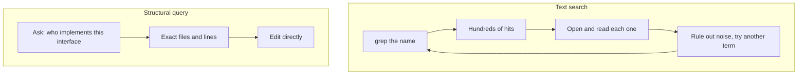

A coding agent is rarely told exactly where a change belongs. You give it the task; it has to find the code—search a name, open files, connect them, search again. **A surprising share of time and tokens burns before a single line is written.**

In a Sonar guest post on Turing Post, a controlled comparison pins this down: semantic code navigation cut cost by about **5% to 36%**, and raises a harder question—did the agent find every place that needed to change?

## Three ways text search fails

`grep` matches characters. When name hits roughly equal real edit sites, that is enough. When the ratio breaks, three causes show up:

1. **Noise flood** — real sites plus hundreds of irrelevant same-name hits; the agent can only open matches one by one and spend budget ruling them out.
2. **Structural links with no shared text** — interface implementations, indirection; the search string never appears near the target.
3. **Wrong same-name symbol** — overloads, shadowed fields; the text lines up, the identity does not.

The first and third mostly make agents **slower and more expensive**. The second is different: miss a file on a simple rename and the build often breaks; miss code only linked by a behavior change and **everything may still compile and pass tests**. Nobody wrote a test for a connection they did not know about. The bug ships later, somewhere that looks unrelated.

## Treat the repo as a graph

Answer those questions from a **code graph**: classes, methods, fields, interfaces, plus calls, implements, extends, references—each pointing at exact file and line. Same idea as IDE “Find All References” / “Go to Implementation.”

Sonar Vortex lets the agent ask via SonarQube CLI or an **MCP server** and get exact locations instead of another name to search. The graph rebuilds without a compiler or language server, so mid-edit broken code stays usable. Roughly a thousand files: seconds to build, about a millisecond to update after a change, as local compute **outside billed agent usage**. In the study it was added as an extra tool, not a swap for existing search.

## What the numbers looked like

Six tasks, four languages; real merged OSS commits as ground truth; prompts **without** file names or line numbers; ten runs per side; a strong model at high effort; only runs that pass build and tests count.

Cost drops included: Java interface change −36%, related package rename −20%, Python / C# cases about −20%, TypeScript −5%, Java argument-order fix −15% on the typical run.

When finding code was not the bottleneck (build/test loops or sheer edit volume), cost stayed within a few percent either way—**having the capability did not hurt**. Wins clustered where the same edit had to land on **every implementor** of a shared interface or base class that text search could not list cleanly.

## Cheaper is not the only point

A structural graph enumerates **connected locations**, not textual matches. That is a different guarantee than “the tests passed.” Many teams adopting coding agents have not measured how much of an agent-driven refactor was verified complete versus assumed complete because nothing failed loudly.

Same root cause, three seats:

- Developer: the agent rereads files it already saw
- Eng leader: cost jumps between similar tasks with no clear trail
- Product: a late defect with no obvious origin

The open question is not only how fast a large refactor finishes—it is **how you would know, concretely, that the agent found everything it needed to.**

## Where the two approaches differ

Every lap of the loop on the left costs tokens, and the loop only ends when the agent decides it has seen enough. The right side gets the boundary from one query. The savings come from fewer laps; the reduced risk comes from a boundary that is known rather than guessed.

## Using this in your own team

Not every task needs this capability. Decide by the shape of the task:

| Task shape | Is text search enough? | Suggestion |
|------------|------------------------|------------|
| Change a uniquely named function | Yes | No extra tooling |
| Change an interface signature or base-class behavior | No; implementers are scattered | Add find-implementations / find-references first |
| Rename a common word (`get`, `id`, `status`) | Extremely noisy | Query by symbol identity |
| Cross-language or cross-service calls | Neither is enough | Rely on contracts and integration tests |
| Generate lots of new code | Bottleneck is build and test | Harmless to add, but don't expect savings |

## How to know it found everything

The article's open question translates into a few everyday habits:

1. **Ask for the list before the edit.** Have the agent list every implementation and call site first, and glance at it before it starts. The list becomes the acceptance criterion.
2. **Reconcile after the edit.** Compare the list with the files in the diff. Any location left untouched needs a reason.
3. **Add one test per implementation of shared interfaces.** Green tests mislead because nobody writes tests for connections they don't know about. Writing tests from the list turns unknowns into knowns.
4. **Keep a ledger.** Track agent token spend by task type. The task types whose cost jumps around are usually the ones where finding code is hardest.

## Takeaway

> Give agents reference-grade navigation, not only grep. A green CI is not the same as a complete change.

Source: [Turing Post — Why Code Search Makes Coding Agents So Expensive](https://www.turingpost.com/p/why-code-search-makes-coding-agents-so-expensive) (Sonar guest post)

## Related posts

- [[coding-agents-reshape-epd|How Coding Agents Reshape Engineering, Product, and Design]]
- [[lovable-future-saas-agent-capabilities|Lovable CTO: The Future of SaaS Is Apps That Agents Can Use]]
- [[warp-self-improving-agents|Warp Self-Improving Agents and the RSI Boundary]]
