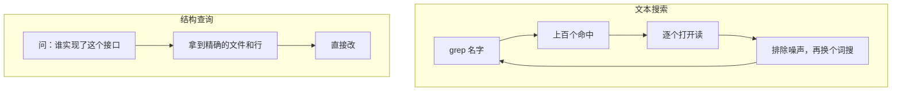

编程 Agent 很少被告知「改哪几行」。你给任务，它自己找代码：搜名字、开文件、理关系、再搜。**很大一块时间和 token，在写出第一行之前就烧掉了。**

Turing Post 刊载的 Sonar 客座文，用一组受控对比把这件事钉死：语义代码导航让成本降了约 **5%–36%**，同时抛出一个更难的问题——Agent 是否找全了每一个该动的位置？

## 纯文本搜索的三种翻车

`grep` 只匹配字符。名字出现次数大致等于真实改动点时，它很好用。比例一崩，通常是三类原因：

1. **噪声洪水**：真改点旁边还有上百个无关同名命中，文本分不清；Agent 只能逐个打开读，烧预算排除噪音。
2. **结构关系无文本**：实现接口、间接调用等，搜索词根本不出现在目标附近——文本搜永远到不了。
3. **同名错符号**：重载、局部变量遮蔽字段……字符串对上了，身份不对。

第一、三类主要让 Agent **更慢更贵**。第二类更阴：简单 rename 漏文件，构建常会立刻炸；**行为变更间接波及的代码**可能仍编译、测试仍过。没人为「不知道的连接」写测试，bug 晚些在看似无关处冒出来。

## 别把仓库当纯文本，当图

解法是把代码建成图：类、方法、字段、接口，以及调用、实现、继承、引用；每一项指向精确文件与行——类似 IDE 的「查找所有引用 / 转到实现」。

Sonar Vortex 让 Agent 通过 SonarQube CLI 或 **MCP Server** 直接问这些问题，拿回精确位置，而不是再搜一个名字。图不依赖编译器 / language server 重建，半残编辑态仍可用；约千文件建图数秒，变更后约 1ms 更新，本地算力**不计入 Agent 计费**。实验里是加工具，不是替换原有搜索。

## 数字长什么样

六任务、四语言；真实已合并 OSS commit 当地面真值；提示**不给文件名行号**；每侧跑 10 次；强模型高 effort；必须过构建与测试才计数。

成本下降示例：Java 接口变更 −36%，相关包重命名 −20%，Python / C# 相关约 −20%，TypeScript −5%，Java 参数顺序典型跑 −15%。

瓶颈不在「找代码」（构建测试循环或改动量巨大）时，有无该能力成本差不多——**备着也不亏**。赢面一致：必须在共享接口 / 基类的**每个实现**上同样落改，纯文本列不干净实现者。

## 比省钱更刺的一点

结构图枚举的是**连通位置**，不是文本命中。这比「测试过了」更接近「该改的都碰到了」。很多团队还没测这个缺口：Agent 驱动的重构里，有多少是被验证完整，有多少只是因为没人当场炸才被当成完整。

同一根因，三个座位：

- 开发者：Agent 反复重读已经看过的文件
- 工程负责人：同类任务成本无迹可循地跳动
- 产品：很晚才出现「起源不明」的缺陷

开放问题不该只是「重构能有多快」，而是：**你怎么具体知道它找全了。**

## 两种找法，差在哪一步

左边的循环每转一圈都在花 token，而且循环何时结束取决于 Agent 自己「觉得够了」；右边一次查询就给出边界。省下的钱主要来自少转几圈，补上的风险来自边界是确定的。

## 放到自己团队怎么用

不是每个任务都值得加这层能力，按任务形态判断：

| 任务形态 | 文本搜索够不够 | 建议 |
|----------|----------------|------|
| 改一个独特命名的函数 | 够 | 不用额外工具 |
| 改接口签名、基类行为 | 不够，实现者散落各处 | 优先接入「找实现 / 找引用」 |
| 重命名常见词（`get`、`id`、`status`） | 噪声极大 | 必须按符号身份查 |
| 跨语言、跨服务调用 | 两种都不够 | 靠接口契约和集成测试兜底 |
| 大批量生成新代码 | 瓶颈在构建测试 | 加了也不亏，但别指望省钱 |

## 怎么知道它找全了

文章抛出的问题，落到日常可以这样做：

1. **改之前先要清单。** 让 Agent 先列出「所有实现 / 所有调用点」，人看一眼再动手。清单本身就是验收标准。
2. **改之后对账。** 把清单和实际 diff 的文件列表对一遍，没碰到的位置要有理由。
3. **对共享接口补「每个实现一条」的测试。** 测试全过之所以骗人，是因为没人为不知道的连接写测试；从清单出发补测试，就是把未知变已知。
4. **记账。** 按任务类型记录 Agent 的 token 花费，成本突然跳动的那类任务，往往就是找代码最费劲的那类。

## 带走一句

> 给 Agent 一把「找引用」级的铲子，别只塞 grep；CI 绿不等于改动完整。

来源：[Turing Post — Why Code Search Makes Coding Agents So Expensive](https://www.turingpost.com/p/why-code-search-makes-coding-agents-so-expensive)（Sonar 客座）

## 相关文章

- [[coding-agents-reshape-epd|编程 Agent 如何重塑工程、产品与设计]]
- [[lovable-future-saas-agent-capabilities|Lovable CTO：SaaS 的未来是 Agent 可用的 Capabilities]]
- [[warp-self-improving-agents|Warp 自我改进 Agent 与 RSI 边界]]
