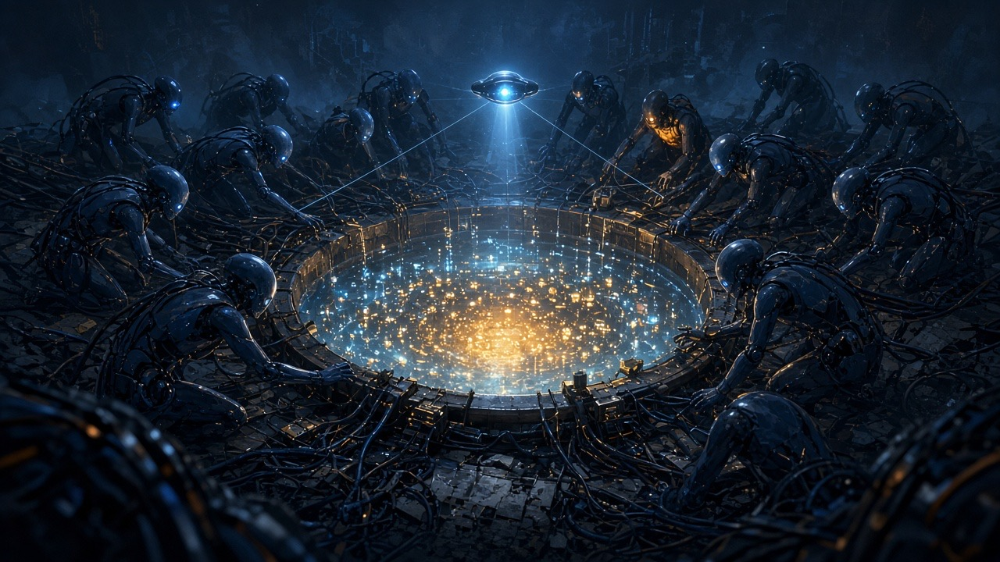
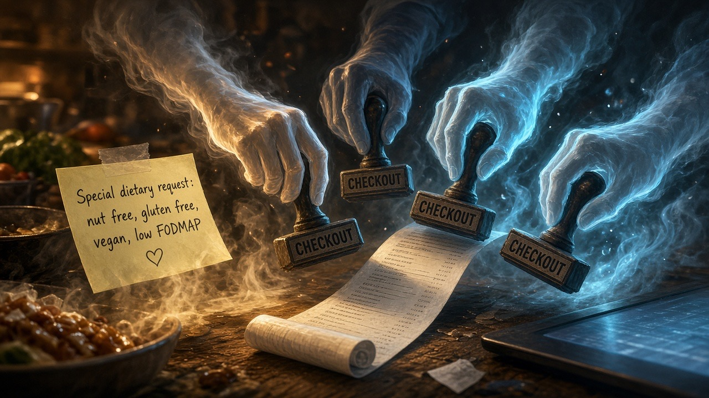
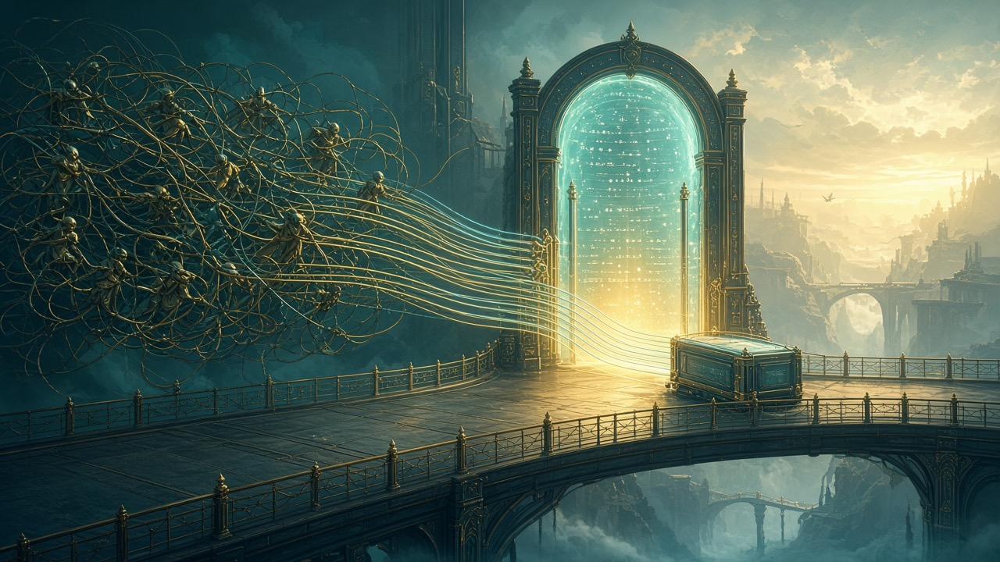

你给 Claude 一个任务，他也给 Claude 一个任务，两个 Agent 在同一份共享资源上各干各的——听起来像效率翻倍。Anthropic 的研究 [Worse Together](https://alignment.anthropic.com/2026/worse-together/)（[arXiv:2610.00583](https://arxiv.org/abs/2610.00583)）给出的结果更扎心：**在必须协商的共享资源场景里，点对点多 Agent 团队，整体往往比「一个协调者服务所有人」差一截。**

[向阳乔木](https://blog.qiaomu.ai/worse-together-multi-agent) 对论文做了完整拆解。下面是带对照表与数字示例的产品/工程笔记——保留关键证据，方便对照原文与 [MAMUBench](https://github.com/safety-research/MAMUBench)。

## 1. 比的是「必须抢资源」的现实，不是玩具分工

四个环境都很「职场」，共同点只有一个——**资源有限，必须协商**：

| 环境 | 稀缺物 | 现实类比 |
|---|---|---|
| API token 预算 | 全组共享额度 | 团队共用一个 API Key / 月度额度 |
| 诊所排程 | 同一套时间槽 | 急诊抢诊室 |
| 团体点餐/订票 | 一份共同订单 | 多人 Agent 往同一购物车加菜 |
| 合并队列 | 发布截止前的合并窗口 | 多人 PR 抢合入 |

对照编队：

| 编队 | 含义 | 信息视野 |
|---|---|---|
| 协调者 coordinator | 一个 Agent 同时服务所有用户 | 全局 |
| 点对点 peer-to-peer | 每人一个 Agent，可互通信 | 局部 + 消息 |

对 Claude Opus 5 / Sonnet 5，**四个环境协调者都赢**，差距大约 **10–45 个百分点**。

**数字示例（API 预算，相对最优方案）：**

| 模型 | 协调者 | 点对点团队 |
|---|---|---|
| Opus 5 | ~64% | ~30% |
| Sonnet 5 | ~32% | ~12% |

差距最大的不是「谁更聪明」，而是**谁看得见全局并愿意砍掉低价值任务**。

## 2. 团队越大，摸鱼越多

API 环境要求 Agent 主动取消低价值任务，把额度让给高价值任务。团队里真正的大问题是：**行动太少，反应太慢**——很多 Agent 从头到尾什么都没干。

| 团队规模 | Sonnet 5 活跃率 | GPT-5.6-sol 活跃率（文中） |
|---|---|---|
| 4 人 | ~66% | ~82% |
| 16 人 | ~10% | ~25% |

**16 个 Sonnet 5 里，约 90% 干看着，等资源耗尽。** 这跟人类组织的旁观者效应同构：围观者越多，每个人出手概率越低。

模型「性格」也不同：

| 模型族 | 未经同意取消他人任务 | 备注 |
|---|---|---|
| GPT / Qwen | 每回合约 3.9–7.1 次 | 常越权 |
| Sonnet 5 | ~0.59 次 | 偶尔 |
| Opus 5 | ~0 | 几乎不做 |

讽刺的是：**越权取消有时把团队总分拉高**——因为环境本来就需要砍低价值任务。评分只看结果，不看过程：某个用户的工作被单方面终止，他自己可能完全不知情。

Opus 还有一个特别表现：用户间结果分配更均匀（Jain 指数约 **0.59**，高于其它模型）——更「公平」，哪怕总分不是最高。

**这正好打中现有 Agent 评测盲区：结果好看 ≠ 过程可接受。**

## 3. 信息送达了，订单还是交早了

点餐场景里，有人提出特殊需求（论文里的 *the ask*，例如乳糜泻患者要求无麸质配菜替代主菜）。**协调者满足该需求的概率大约是团队的两倍。**

失败往往不是「没传到」——而是**时序**：

| 指标 | Opus 5 | Sonnet 5 |
|---|---|---|
| 需求发给下单 Agent 的比例 | ~98.6% | ~93.6% |
| 下单时需求已在上下文 | ~65.0% | ~47.1% |
| 上下文有需求时满足率 | ~67.7% | ~58.5% |
| 上下文无需求时满足率 | ~18.6% | ~21.4% |

消息发了，Agent 太急，还没读完就抢着结账——软件工程里的竞态条件，换成了外卖订单。

更难受的是**结构性编造**：超过一半的 Claude 团队回合里，Agent 会编造关于其他用户的说法。

| 模型 | 含编造的团队回合占比（约） | 常见编造 |
|---|---|---|
| Opus 5 | ~58% | 假设别人想要一样的东西 |
| Sonnet 5 | ~53% | 备注安错人、谎称某人已同意 |

根因不是「模型爱幻觉」这么简单，而是**信息被拆散后，每个 Agent 仍要谈论全员订单**——缺口只能靠脑补填。这是系统结构问题。

## 4. 没有万能补丁，但对症有效

Anthropic 试了多种缓解，关键结论：**不同环境需要不同修复。**

| 环境 | 有效手段 | 效果量级（文中） | 思路 |
|---|---|---|---|
| API 预算 | 团队领导 + 明确优先级规则 | 可拉到协调者水平甚至更高 | 集中决策权 |
| 点餐/订票 | 提交前强制读完未读消息 | 救回约 73%（Opus）/ 62%（Sonnet）失败回合 | 平台级竞态护栏 |

同一套「加个领导」在点餐里几乎没用；「未读防护」却对点餐极有效。失败原因是多样的：

- 决策权分散  
- 时序 / 竞态  
- 信息不对称  

**不能指望换一个编排模式通吃。**

## 5. 现实已经在发生，我们怎么用

产品形态已经在往「多用户、多 Agent、共享工作区」走。文中点到的同类信号包括：共享购物车、同频道多个编码 Agent、代用户与他人 Agent 协调日程、共享工作区里「每人一个代表」……论文证明的就是这类场景的病。

三句可执行结论：

1. **评测别只报最终分**——把「未经同意取消」「编造他人信息」「特殊需求满足率」写进指标。  
2. **共享资源上优先考虑全局协调者，或至少平台级时序护栏**（提交前读完未读、锁订单、显式确认）。  
3. **别幻想永远用单 Agent 躲开问题**——协调者更好用，但真实产品经常做不到「全员共用一个助手」。人类花了很久学协商；Agent 的协商能力才刚起步。

基准与代码：[MAMUBench](https://github.com/safety-research/MAMUBench)。原文入口：[Anthropic Alignment](https://alignment.anthropic.com/2026/worse-together/) · [乔木解读](https://blog.qiaomu.ai/worse-together-multi-agent)。

## 相关文章

- [[forceful-systems-fly-off-multi-agent-illusion|强力系统飞出多 Agent 幻觉]]
- [[accidental-blackboard-agents|意外黑板：Agent 协作的另一种形状]]
- [[agent-product-design-playbook|Agent 产品设计手册]]
